<div align="center">

# 🍽️ DineFlow

**Restaurant Management System**

Table floor plan · POS & KOT · Kitchen display · Recipe-based inventory · Reservations · Billing with service charge & VAT · Loyalty points · Online ordering · Reports


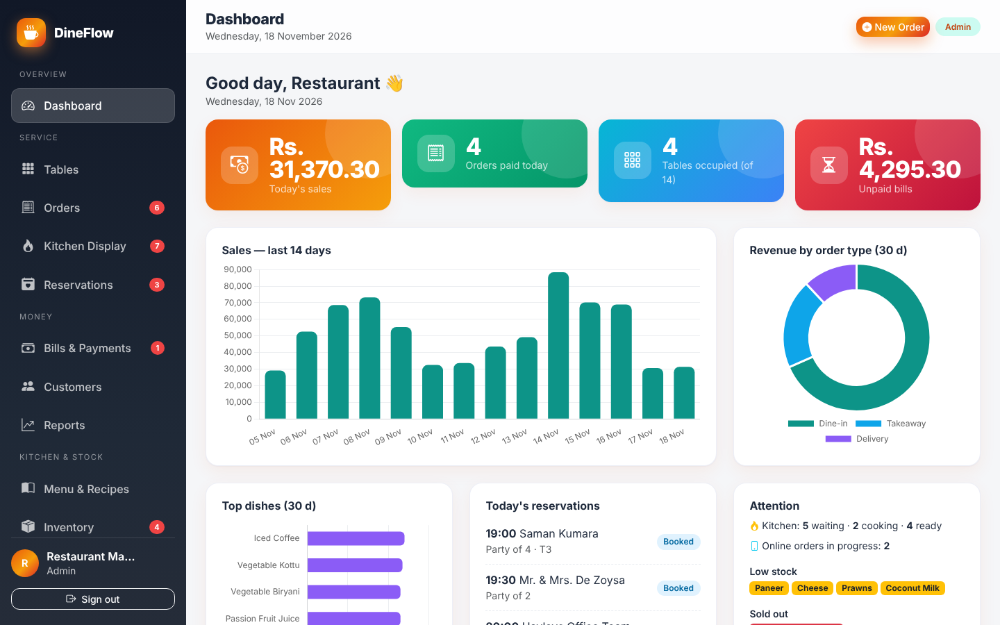

<sub>Built by **Chandra Kumar Vishanan** · HND in Information Technology (HNDIT) – SLIATE</sub>

</div>

## ✨ Features

| Area | What you get |
|---|---|
| **Floor plan** | Live table board (Available / Occupied / Cleaning) with running totals, order age, "ready to serve" alerts and today's reservations; auto-refreshes every 15 s |
| **POS / orders** | Dine-in, Takeaway and Delivery. Tap-to-add menu with notes, draft lines → **Send to kitchen (KOT)**, extra rounds create KOT #2, #3…, move table, cancel with role rules |
| **Kitchen display** | Tickets grouped by order + KOT, Kitchen / Bar stations, colour-coded by age vs. prep time, Start → Ready → Served |
| **Recipes & stock** | Each dish has a recipe. Starting a dish **deducts ingredient stock automatically** (blocked if there isn't enough); receive deliveries, wastage, stock-take adjustments, full movement history, low-stock alerts, food-cost and margin per dish |
| **Reservations** | 30-minute slots, 90-minute stay, **race-safe** booking with automatic table assignment, duplicate-phone guard, seat guests straight into an order |
| **Billing** | Discounts (cashier ≤ 20 %, manager unlimited), **loyalty points**, 10 % service charge (dine-in), 18 % VAT, Cash / Card / Online, partial payments, overpay protection, **PDF invoice**, cancel unpaid bill & reopen |
| **Online ordering** | Customers log in, order takeaway or delivery, track progress and cancel while the kitchen hasn't started |
| **Customers & loyalty** | Profiles, visit history, favourite dishes, 1 point per Rs. 100 spent |
| **Reports** | Sales, average bill, margin, VAT, service, discounts, payment methods, hourly demand, top dishes, waiter performance, best customers, **CSV export** |
| **Roles** | Admin (manager), Waiter, Chef, Cashier, Customer – separate dashboards, menus and data scope |
| **Security** | PDO prepared statements, `password_hash`, CSRF tokens, login lockout, role guards on pages *and* APIs, customers can only see their own data, CSV-injection-safe export, audit log |

## 🖼️ Screenshots

| Floor plan | POS order screen |
|---|---|
| 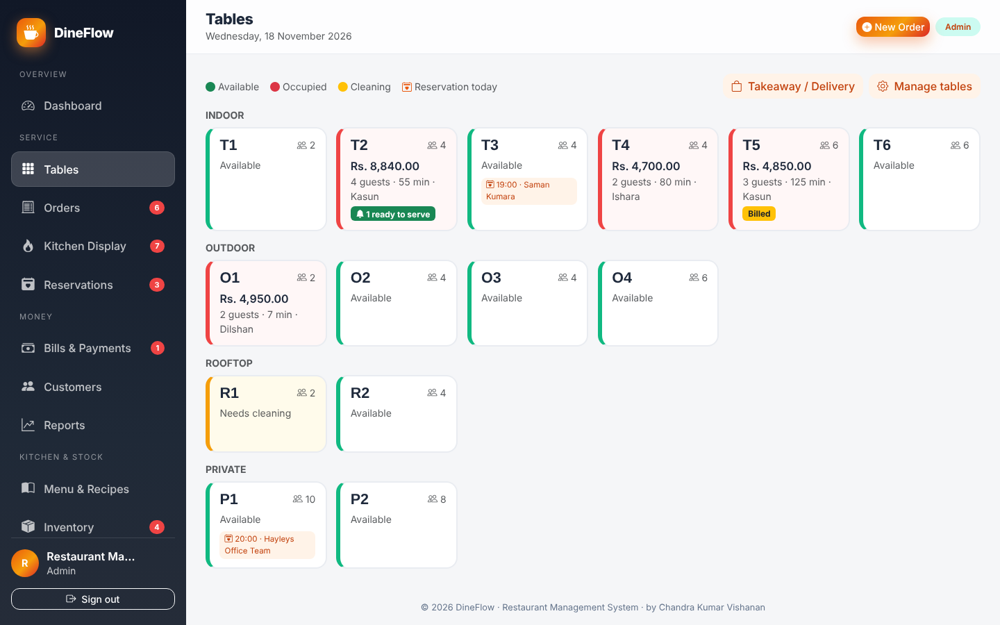 | 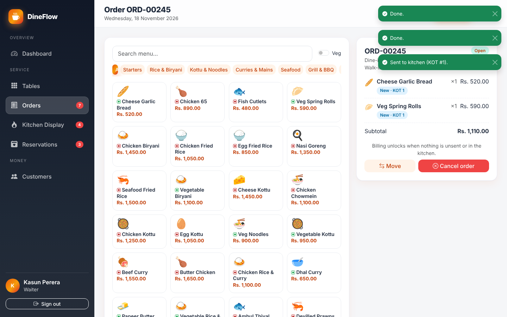 |

| Kitchen display | Bill & payment |
|---|---|
| 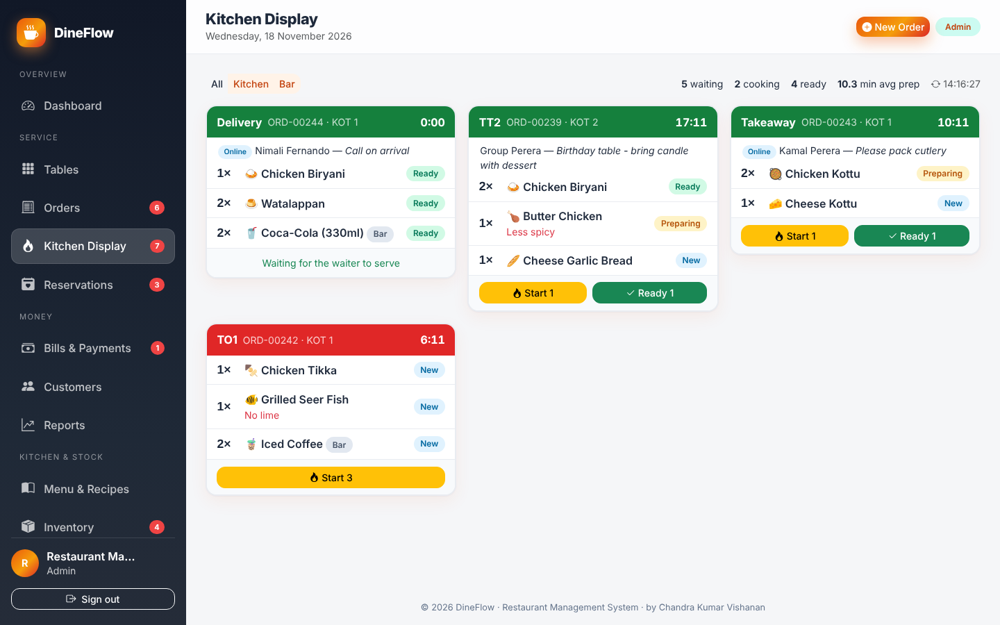 | 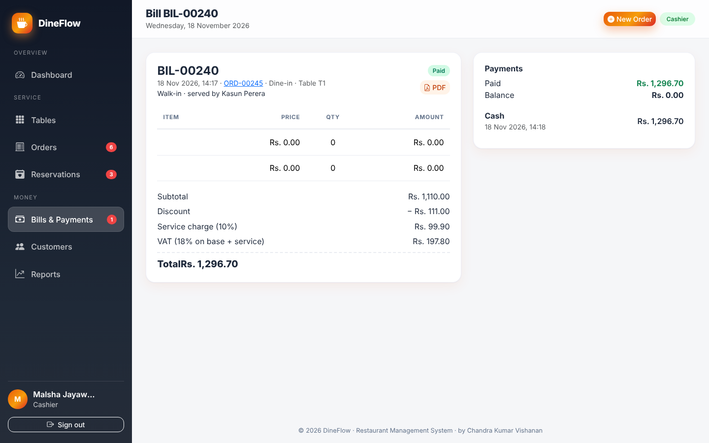 |

| Menu & recipes | Inventory |
|---|---|
| 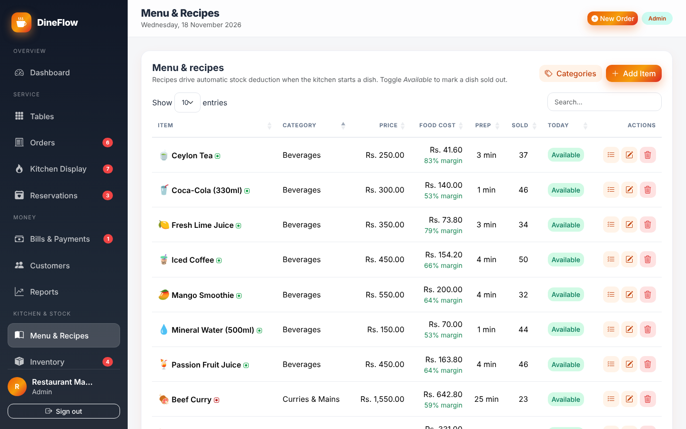 | 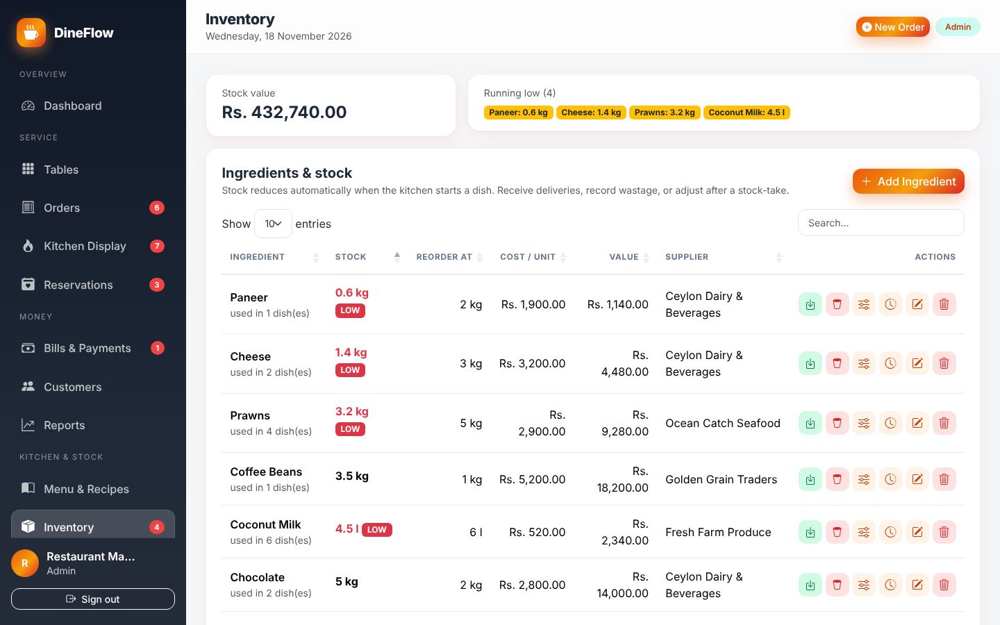 |

| Reservations | Online ordering |
|---|---|
| 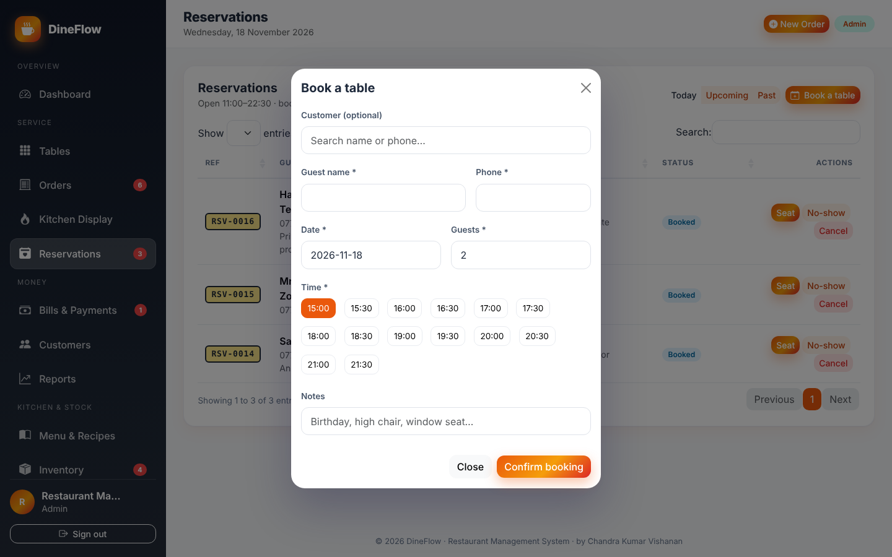 | 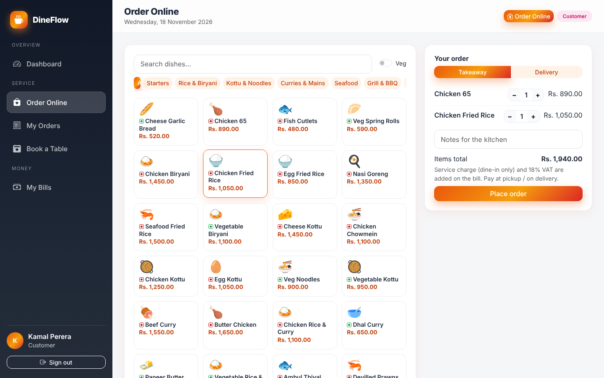 |

| Reports | Mobile |
|---|---|
| 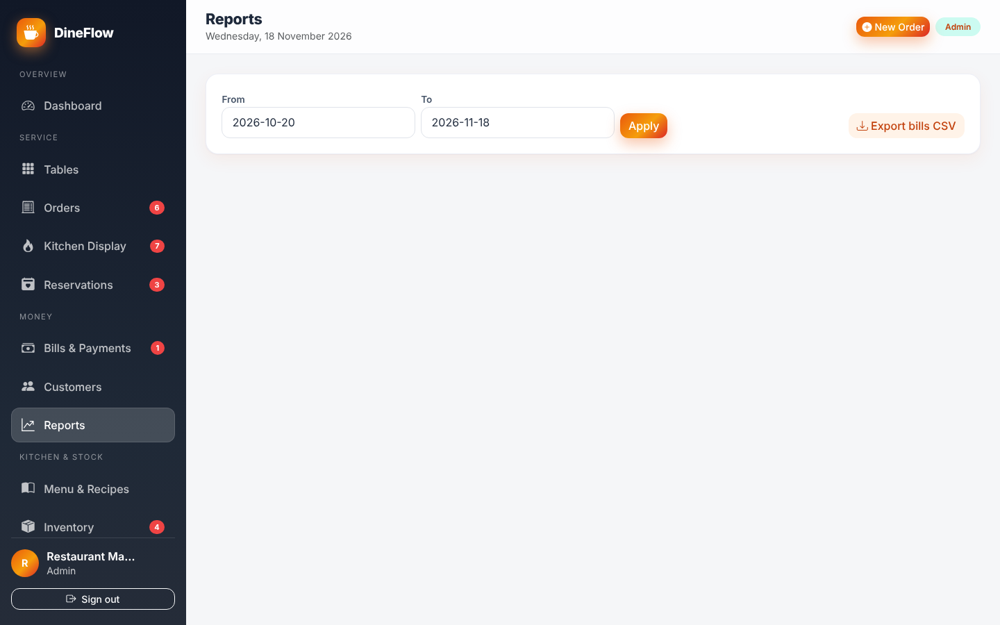 | 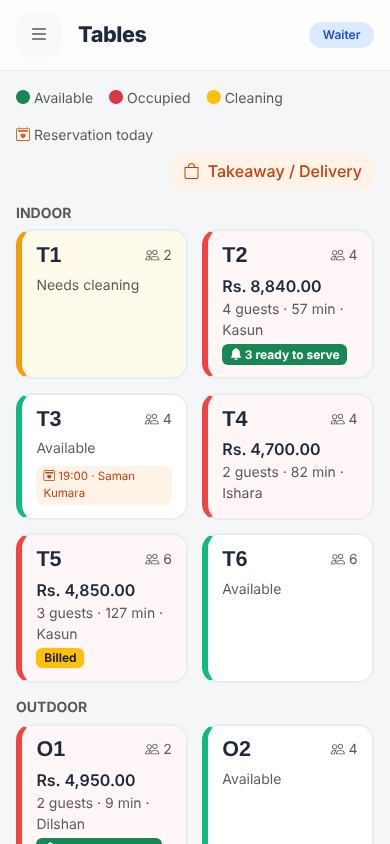 |

More in [`docs/screenshots`](docs/screenshots) (all five dashboards, customer tracker, billing modal, …).

## 🧰 Tech stack

Core **PHP 8** (no framework) · **PDO** · MySQL / MariaDB · **Bootstrap 5** · vanilla JavaScript · DataTables · Chart.js · Flatpickr · **FPDF** (bundled).

## 🚀 Installation (WAMP)

1. Copy the folder to `C:\wamp64\www\restaurant_management`.
2. Start WAMP, open **phpMyAdmin** → *Import* → choose `sql/database.sql` (it creates the `restaurant_management` database and seeds demo data).
3. Check `config/config.php` (DB user `root`, empty password by default on WAMP).
4. Make sure Apache `mod_rewrite` is on (WAMP icon → Apache → Apache modules → `rewrite_module`).
5. Open **http://localhost/restaurant_management/**.

> If you use a different folder name, change `APP_BASE` in `config/config.php` **and** `RewriteBase` in `.htaccess`.
> Bootstrap, icons, Chart.js etc. load from CDNs, so the browser needs internet access.

## 🔑 Demo logins

| Role | Username | Password |
|---|---|---|
| Manager (Admin) | `admin` | `admin123` |
| Waiter | `waiter1` (also `waiter2`, `waiter3`) | `waiter123` |
| Chef | `chef1` (also `chef2`) | `chef123` |
| Cashier | `cashier1` | `cashier123` |
| Customer | `customer1` … `customer6` | `customer123` |

**Change all demo passwords, set `APP_DEBUG` to `false`, and remove the demo-accounts box from `login.php` before going live.**

## 🧾 Business rules

- **Order flow:** Draft → *Send to kitchen* (KOT) → New → Preparing → Ready → Served. A bill can be generated only when nothing is Draft / New / Preparing.
- **Billing formula:** `base = subtotal − discount − points value`; `service = 10 % × base` (dine-in only); **`VAT = 18 % × (base + service)`** — tax is applied on the base **plus** the service charge; `total = base + service + VAT`.
- **Discounts:** only Cashier / Manager; cashier is capped at 20 % of the subtotal.
- **Loyalty:** 1 point per Rs. 100 of the paid total, 1 point = Rs. 1, redeemable up to 50 % of the bill. Points are deducted when the bill is generated and refunded if the bill is cancelled; a bill with payments cannot be cancelled.
- **Payments:** Cash / Card / Online, partial allowed, never above the balance. When fully paid the order closes, the table moves to *Cleaning*, customer stats/points update and a linked reservation completes.
- **Stock:** recipes are deducted when the kitchen starts a dish; stock can never go negative (DB `CHECK` + row locks).
- **Reservations:** open 11:00–21:30 in 30-min slots for the next 30 days; a table is held for 90 minutes; customers may hold up to 3 upcoming bookings; cancel ≥ 2 h ahead.
- **Online orders:** takeaway/delivery only, max 3 in progress per customer, cancellable only while every item is still *New*.
- **Roles:** only Chef/Manager cook; only Waiter/Cashier/Manager serve; only Manager cancels an order once food has been prepared.

## 🗂️ Project structure

```
config/        settings + PDO connection
includes/      auth, CSRF, CRUD controller, base model, models/ (Order, Kitchen, Bill, Reservation, …)
modules/       tables · orders · kitchen · reservations · bills · menu · inventory · customers · portal · reports · users · audit · dashboard
assets/        css, js (crud.js, pos.js, kitchen.js, …)
sql/           database.sql  (schema + seed)
tests/         smoke, end-to-end and Playwright UI tests
docs/          screenshots
```

## 🧪 Tests

```bash
cd tests
python3 smoke_pages.py        # every page for every role
python3 e2e_lifecycle.py      # order → kitchen → bill → payment, rules, role guards, reservations, online orders
python3 e2e_rules.py          # stock deduction, sold-out, loyalty refund, reservation seating
node ui_playwright.js         # browser flow + screenshots (needs playwright)
```
Set `BASE=http://localhost/restaurant_management` if you are not on port 8080. Run on a freshly imported database (the tests create data). Current result: **115 API checks + 13 UI checks passing**, 0 browser errors, and data-integrity queries (negative stock, overpayment, payment/stock ledger mismatch) all return 0.

## 👤 Author

**Chandra Kumar Vishanan** — HND in Information Technology (HNDIT), SLIATE

## 📄 License

Released under the [MIT License](LICENSE).
